# Relatório Técnico: Mapeamento do Diagrama de Análise para o Diagrama de Classes de Projeto
**Projeto:** FHIR SUS+ · **Recorte:** Projeto Integrador P3  
**Frente:** API / Gateway · **Responsável:** Bruno Carvalho Santana Rocha (@BrunocsRocha)  
**Data:** 22/11/2026 · **Versão:** 1.0  
**Rastreabilidade:** Diagrama de Classes de Análise (P2 §5.1, MOD-01 a MOD-06), Diagrama de Sequência (P2 §6.1, SD01), ADRs (ADR03, ADR05, ADR09) e Contratos (CT-01 a CT-05).

---

## 1. Finalidade do Relatório

Este documento tem como objetivo servir como **fundamentação e guia técnico oficial para a elaboração do Diagrama de Classes de Projeto (UML de Implementação)** do projeto FHIR SUS+.

Ele cataloga **todas as classes Java desenvolvidas nas 5 issues da frente API/Gateway (API-01 a API-05)** e detalha como cada uma delas deriva da classe conceitual **`Gateway`** (e de suas fronteiras com `MotorConversao` e integrações externas) presente no **Diagrama de Classes de Análise (P2)**.

---

## 2. Visão Geral da Transição: Análise ➔ Projeto

No **Diagrama de Classes de Análise (P2 §5.1)**, a arquitetura conceitual previa uma única classe abstrata chamada `Gateway`, com a seguinte estrutura conceitual:

```
+-------------------------------------------------------------+
|                          <<analysis>>                       |
|                            Gateway                          |
+-------------------------------------------------------------+
| - idGateway: String                                         |
| - endpointClinica: String                                   |
| - endpointLaboratorio: String                               |
| - statusOperacional: Status                                 |
+-------------------------------------------------------------+
| + receberSolicitacao(payload: FHIR): Bundle                 |
| + pipeline_FHIRToLegado(sr: ServiceRequest): JSON           |
| + despacharParaLaboratorio(json: JSON): JSON                |
| + pipeline_legadoToFHIR(laudo: JSON): Bundle                |
| + verificarSaude(): Status                                  |
+-------------------------------------------------------------+
```

### Por que a classe conceitual `Gateway` não pode ser uma única classe no código?
Manter essa estrutura como uma classe única violaria os princípios de **Responsabilidade Única (SRP - SOLID)**, **Alta Coesão e Baixo Acoplamento (GRASP)** e os atributos de qualidade exigidos pelo projeto:
1. **Separation of Concerns (SoC) e Arquitetura em Camadas (Layered Architecture):** Protocolos HTTP/REST (Web) não devem se misturar com regras de orquestração clínica (Application), nem com regras de validação (Domain) ou comunicação de sockets com timeout (Infrastructure).
2. **Estilo Arquitetural Pipes and Filters (P2/P3):** O processamento do exame precisa ser executado através de filtros independentes e determinísticos (Validação $\rightarrow$ Transformação $\rightarrow$ Envio $\rightarrow$ Retransformação $\rightarrow$ Agregação), permitindo que cada filtro seja testado e substituído isoladamente.
3. **Resiliência e Timeout Configurável (RF016 / CT-04):** A comunicação de rede com sistemas externos instáveis exige isolamento em cliente HTTP dedicado com tratamento de falhas transientes e erros 502/504.

Por essas razões, a classe conceitual `Gateway` foi desdobrada em **16 classes de produção** organizadas em camadas especializadas, além da ponte de integração oficial com as classes dos colegas (`MotorConversao`, `ValidadorFhir`, `ConfigService`). Todas as classes e definições temporárias criadas na fase de isolamento (`MockConversionEngine`, `br.ufs.fhirsus.engine.SentidoConversao`, `br.ufs.fhirsus.engine.FalhaConversao`) foram integralmente removidas após o merge, garantindo que o código em produção consuma 100% dos artefatos oficiais reais.

---

## 3. Matriz de Rastreabilidade: Análise ↔ Classes de Projeto

| Classe Conceitual (Análise) | Classe de Projeto (Código Java) | Pacote (`package`) | Camada Arquitetural | Issue | Papel no Pipeline Pipes & Filters |
|---|---|---|---|---|---|
| **`Gateway`** (RF001, ADR03) | `ClinicalGatewayController` | `br.ufs.fhirsus.controller` | Apresentação (Web) | API-02 / API-04 | **Entrada do Pipeline (Ingress):** Recebe requisições HTTP REST em `POST /api/v1/clinical/requests` com `application/json` ou `application/fhir+json`. |
| **`Gateway`** (RF001, SD01, MOD-01) | `ClinicalOrchestratorService` | `br.ufs.fhirsus.service` | Aplicação (Service) | API-04 | **Coordenador do Pipeline:** Conecta os Filtros 1 a 5, gerencia transição de dados e orquestra o ciclo síncrono completo. Integrado ao validador HAPI FHIR R4. |
| **`Gateway`** (RF017, ADR09) | `ServiceRequestValidator` | `br.ufs.fhirsus.validator` | Domínio / Validação | API-02 | **Filtro 1:** Validação sintática e semântica de entrada (`Bundle` collection e `ServiceRequest` isolado), integrando-se nativamente ao `ValidadorFhir` (HAPI FHIR R4). |
| **`Gateway`** (Record Auxiliar) | `ValidClinicalInput` | `br.ufs.fhirsus.validator` | Domínio / Value Object | API-02 | Encapsula o resultado imutável da validação do Filtro 1 (`numeroPedido`, `codigoExame`, `pacienteCodigo`, nós JSON). |
| **`MotorConversao`** (CT-02 / MOD-01) | `ConversionEngine` *(interface)* | `br.ufs.fhirsus.engine` | Domínio / Integração | API-04 | Contrato do **Filtro 2 e Filtro 4:** Interface pura desacoplada, utilizando `br.ufs.fhirsus.map.SentidoConversao`. |
| **`MotorConversao`** (CT-02, GoF Adapter) | `MotorConversaoAdapter` | `br.ufs.fhirsus.engine` | Domínio / Adaptador | API-04 / Integração | **Adaptador Oficial (@Primary):** Implementa `ConversionEngine`, conectando o pipeline ao `MotorConversao` oficial de Luiz Manoel e ao `ConfigService` de Danilo Campos no PostgreSQL. |
| **`Gateway`** (RF016, ADR03) | `LabLegacyClient` | `br.ufs.fhirsus.client` | Infraestrutura (HTTP Client) | API-03 | **Filtro 3:** Transmissão HTTP POST para o laboratório utilizando `java.net.http.HttpClient` do Java 21 com timeout de socket e conexão. |
| **`Gateway`** (RF016, Tática Config) | `LabClientProperties` | `br.ufs.fhirsus.client` | Infraestrutura / Config | API-03 | Objeto `@ConfigurationProperties(prefix = "lab.client")` externalizando `baseUrl` e `timeoutMs`. |
| **`Laboratório Legado`** (RF016, CT-05) | `LabMockController` | `br.ufs.fhirsus.mock` | Infraestrutura / Mock | API-03 | Simula o sistema laboratorial externo em `POST /mock/lab/pedidos`, com validação estrita, protocolo dinâmico e headers de falha/atraso. |
| **`Gateway`** (ADR03, CT-04) | `GlobalExceptionHandler` | `br.ufs.fhirsus.exception` | Apresentação (Cross-Cutting) | API-02 / 03 / 04 | Interceptador global `@RestControllerAdvice` que traduz qualquer falha (incluindo `br.ufs.fhirsus.map.FalhaConversao`) para o envelope HL7 FHIR `OperationOutcome`. |
| *(Tratamento de Erros)* | `InvalidPayloadException` | `br.ufs.fhirsus.exception` | Domínio / Exceção | API-02 | Lançada para payloads JSON vazios ou malformados $\rightarrow$ mapeada para **HTTP 400**. |
| *(Tratamento de Erros)* | `FhirValidationException` | `br.ufs.fhirsus.exception` | Domínio / Exceção | API-02 | Lançada para campos obrigatórios ausentes ou recursos incompatíveis $\rightarrow$ mapeada para **HTTP 422**. |
| *(Resiliência de Rede)* | `LabTimeoutException` | `br.ufs.fhirsus.exception` | Infraestrutura / Exceção | API-03 | Lançada quando a resposta do laboratório estoura o tempo limite $\rightarrow$ mapeada para **HTTP 504**. |
| *(Resiliência de Rede)* | `LabUnavailableException` | `br.ufs.fhirsus.exception` | Infraestrutura / Exceção | API-03 | Lançada quando o laboratório está fora do ar ou responde HTTP 5xx $\rightarrow$ mapeada para **HTTP 502**. |
| **`Gateway`** (Monitoramento) | `HealthController` | `br.ufs.fhirsus.controller` | Apresentação (Web) | API-01 | Rota `GET /api/v1/health` para verificação de disponibilidade operacional do Gateway. |
| **`Gateway`** (DTO de Saúde) | `HealthStatusDto` | `br.ufs.fhirsus.dto` | Apresentação / DTO | API-01 | Record imutável com status `UP`, versão `1.0.0-P3`, timestamp e metadados do P3. |
| **`Gateway`** (DTO de Recepção) | `ClinicalReceptionResponseDto` | `br.ufs.fhirsus.dto` | Apresentação / DTO | API-02 | Record imutável de confirmação da recepção da solicitação na Issue 02. |
| **`Gateway`** (Envelope de Erro FHIR) | `OperationOutcomeDto` | `br.ufs.fhirsus.dto.fhir` | Apresentação / DTO FHIR | API-02 | Record estruturado compatível com o recurso HL7 FHIR R4 `OperationOutcome` e sua lista de `Issue`. |
| *(Inicialização Spring Boot)* | `FhirsusApplication` | `br.ufs.fhirsus` | Configuração / Main | API-01 | Ponto de entrada da aplicação Spring Boot. |

---

## 4. Diagrama de Classes de Projeto (UML Completo)

Abaixo está a representação formal do **Diagrama de Classes de Projeto** em notação Mermaid, modelando as camadas, visibilidades, atributos, métodos e relacionamentos de dependência, injeção e realização:

```mermaid
classDiagram
    direction TB

    %% =========================================================================
    %% CAMADA WEB / APRESENTAÇÃO
    %% =========================================================================
    class ClinicalGatewayController {
        -ClinicalOrchestratorService orchestratorService
        +ClinicalGatewayController(ClinicalOrchestratorService orchestratorService)
        +receberRequisicaoClinica(JsonNode payload, boolean simularFalha, long delayMs) ResponseEntity~JsonNode~
    }

    class HealthController {
        +healthCheck() ResponseEntity~HealthStatusDto~
    }

    class GlobalExceptionHandler {
        +handleInvalidPayload(InvalidPayloadException ex) ResponseEntity~OperationOutcomeDto~
        +handleHttpMessageNotReadable(HttpMessageNotReadableException ex) ResponseEntity~OperationOutcomeDto~
        +handleFhirValidation(FhirValidationException ex) ResponseEntity~OperationOutcomeDto~
        +handleFalhaConversao(FalhaConversao ex) ResponseEntity~OperationOutcomeDto~
        +handleLabTimeout(LabTimeoutException ex) ResponseEntity~OperationOutcomeDto~
        +handleLabUnavailable(LabUnavailableException ex) ResponseEntity~OperationOutcomeDto~
    }

    %% =========================================================================
    %% CAMADA DE APLICAÇÃO (ORQUESTRAÇÃO)
    %% =========================================================================
    class ClinicalOrchestratorService {
        -ServiceRequestValidator validator
        -ConversionEngine conversionEngine
        -LabLegacyClient labClient
        -ObjectMapper objectMapper
        +ClinicalOrchestratorService(ServiceRequestValidator, ConversionEngine, LabLegacyClient)
        +processarFluxoCompleto(JsonNode payload) ObjectNode
        +processarFluxoCompleto(JsonNode payload, boolean simularFalha, long delayMs) ObjectNode
        -montarBundleLaudoFinal(ValidClinicalInput input, JsonNode respostaLab) ObjectNode
    }

    %% =========================================================================
    %% CAMADA DE DOMÍNIO (FILTROS DO PIPELINE E CONVERSÃO)
    %% =========================================================================
    class ServiceRequestValidator {
        +validar(JsonNode root) ValidClinicalInput
        -extrairNumeroPedido(JsonNode sr) String
        -extrairCodigoExame(JsonNode sr) String
        -extrairCodigoPaciente(JsonNode pat) String
    }

    class ValidClinicalInput {
        <<record>>
        +String numeroPedido
        +String codigoExame
        +String pacienteCodigo
        +JsonNode serviceRequestNode
        +JsonNode patientNode
    }

    class ConversionEngine {
        <<interface>>
        +converter(JsonNode payload, String recurso, SentidoConversao sentido) ObjectNode
    }

    class MockConversionEngine {
        -ObjectMapper objectMapper
        +converter(JsonNode payload, String recurso, SentidoConversao sentido) ObjectNode
        -converterServiceRequestParaLegado(JsonNode sr) ObjectNode
        -converterLegadoParaObservation(JsonNode item) ObjectNode
        -converterLegadoParaDiagnosticReport(JsonNode laudo) ObjectNode
    }

    class SentidoConversao {
        <<enumeration>>
        TO_LEGADO
        TO_FHIR
    }

    %% =========================================================================
    %% CAMADA DE INFRAESTRUTURA E COMUNICAÇÃO EXTERNA
    %% =========================================================================
    class LabLegacyClient {
        -LabClientProperties properties
        -ObjectMapper objectMapper
        -HttpClient httpClient
        +LabLegacyClient(LabClientProperties properties)
        +enviarPedidoLegado(JsonNode pedidoLegado) JsonNode
        +enviarPedidoLegado(JsonNode pedidoLegado, boolean simularFalha, long delayMs) JsonNode
    }

    class LabClientProperties {
        -String baseUrl
        -int timeoutMs
        +getBaseUrl() String
        +setBaseUrl(String baseUrl) void
        +getTimeoutMs() int
        +setTimeoutMs(int timeoutMs) void
    }

    class LabMockController {
        -ObjectMapper objectMapper
        +receberPedidoLegado(JsonNode pedidoLegado, boolean simularFalha, long delayMs) ResponseEntity
    }

    %% =========================================================================
    %% DTOS E EXCEÇÕES
    %% =========================================================================
    class OperationOutcomeDto {
        <<record>>
        +String resourceType
        +List~Issue~ issue
        +of(String severity, String code, String diagnostics, String expression)$ OperationOutcomeDto
    }

    class HealthStatusDto {
        <<record>>
        +String status
        +Instant timestamp
        +String gateway
        +String versao
        +Map detalhes
        +up()$ HealthStatusDto
    }

    class FalhaConversao {
        -String codigo
        -String caminho
        +getCodigo() String
        +getCaminho() String
    }

    class FhirValidationException {
        -String campo
        -String codigoErro
        +getCampo() String
        +getCodigoErro() String
    }

    class LabTimeoutException {
        +LabTimeoutException(String message)
    }

    class LabUnavailableException {
        +LabUnavailableException(String message)
    }

    %% =========================================================================
    %% RELACIONAMENTOS DE ASSOCIAÇÃO, INJEÇÃO E REALIZAÇÃO
    %% =========================================================================
    ClinicalGatewayController --> ClinicalOrchestratorService : delega fluxo
    ClinicalOrchestratorService --> ServiceRequestValidator : Filtro 1
    ClinicalOrchestratorService --> ConversionEngine : Filtros 2 e 4
    ClinicalOrchestratorService --> LabLegacyClient : Filtro 3
    MockConversionEngine ..|> ConversionEngine : realiza contrato CT-02
    MockConversionEngine ..> SentidoConversao : usa
    MockConversionEngine ..> FalhaConversao : lanca
    ServiceRequestValidator ..> ValidClinicalInput : produz
    ServiceRequestValidator ..> FhirValidationException : lanca
    LabLegacyClient --> LabClientProperties : configurado por
    LabLegacyClient ..> LabTimeoutException : lanca (504)
    LabLegacyClient ..> LabUnavailableException : lanca (502)
    GlobalExceptionHandler ..> OperationOutcomeDto : retorna
    HealthController ..> HealthStatusDto : retorna
```



---

## 5. Relação com as Outras Frentes do Projeto

Este modelo de classes de projeto estabelece fronteiras claras e sem atrito para a integração coletiva:

1. **Frente Motor de Conversão (Luiz Manoel - CONV-01..05):**
   * A classe `ConversionEngine` é a interface estável.
   * Quando o motor real `br.ufs.fhirsus.map.MotorConversao` estiver concluído, basta criar a classe `MotorConversaoAdapter implements ConversionEngine` e anotá-la com `@Primary`. O `ClinicalOrchestratorService` passará a usar o motor real sem alterar nenhuma linha.
2. **Frente Validação e QA (Filipe Ciríaco - QA-01..05):**
   * O validador HAPI FHIR oficial será injetado no `ClinicalOrchestratorService`: antes da chamada do Filtro 1 (validação de entrada) e no final do Filtro 5 (validação de conformidade do Bundle gerado).
   * As falhas do HAPI FHIR disparam exceções capturadas pelo `GlobalExceptionHandler`, mantendo o `OperationOutcome` padronizado.
3. **Frente Banco de Dados e Configuração (Danilo Campos - DB-01..05):**
   * O `ClinicalOrchestratorService` capturará a instância ativa de mapeamento (`MapeamentoConfig`) através de um serviço de consulta e repassará a mesma instância na ida e na volta do laboratório, garantindo consistência transacional.
4. **Frente Interface do Usuário / Frontend (Arthur Barreto - FE-01..05):**
   * O frontend consumirá os endpoints REST documentados em `ClinicalGatewayController` (`POST /api/v1/clinical/requests`) e `HealthController` (`GET /api/v1/health`), recebendo diretamente o Bundle HL7 FHIR R4 ou o `OperationOutcome` padronizado.

---

## 6. Classes de Testes Desenvolvidas

Para garantir a confiabilidade e verificação empírica contínua, foram criadas **8 classes de teste automatizado**, totalizando **29 casos de teste passando com 100% de sucesso**:

1. `GatewayScenariosTestSuiteTest`: 11 cenários cobrindo a matriz completa com 10 fixtures JSON do classpath.
2. `PipelineFiltersInspectionTest`: Teste de inspeção didática imprimindo a entrada e saída de cada um dos 5 filtros.
3. `ClinicalGatewayControllerTest`: 7 cenários validando o controller clínico, cabeçalhos e tratamento de exceções.
4. `LabMockControllerTest`: 5 cenários validando o mock de laboratório (sucesso, rejeição estrita de campos e simulação de erro 500).
5. `LabLegacyClientTest`: 4 cenários testando cliente HTTP de rede real contra servidor efêmero (sucesso, timeout, erro 500 e servidor fora do ar).
6. `ClinicalOrchestratorServiceTest`: 1 cenário validando orquestração, correlação interna de UUIDs e montagem do Bundle.
7. `HealthControllerTest`: 1 cenário validando a rota `/api/v1/health`.
8. `FhirsusApplicationTests`: 1 teste de integridade do contexto Spring Boot.
